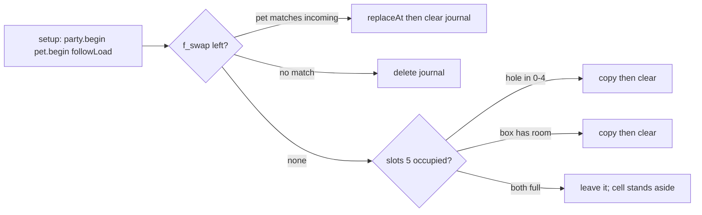

# Phased implementation: party follower switching

Spec: [party_follower_switching_a573f864.plan.md](.cursor/plans/party_follower_switching_a573f864.plan.md). Fork rules match [FORK.md](FORK.md) and the wild feature: new files, `f`_ keys, `// FORK(follow)` hooks, no edits to README, CLAUDE.md, `FW_VERSION`, or existing tests.

Branch `pt/follow-switch` off the fork `main`. Do not call `followLoad()` from `Party::begin()`. [box_test.cpp](tools/emu/tests/box_test.cpp), [save_test.cpp](tools/emu/tests/save_test.cpp), [moves_test.cpp](tools/emu/tests/moves_test.cpp), and [touch_test.cpp](tools/emu/tests/touch_test.cpp) seed six members by writing `slots[]` and never call `followLoad()`, so a boot-only migration keeps them green. `pickCandidates()` keeps looping all `PARTY_SLOTS`.

## File split

[follow.h](follow.h) / [follow.cpp](follow.cpp) stay free of the sketch, same as [wild.cpp](wild.cpp): fingerprint, `FollowExt`, journal, `followCanSwitch`, `followSwitch`, `followLoad` / `followSave`, `followSerial`, `FT()`.

Drawing and taps need `gfx`, `partyDetail`, `boxSel`, `partyPick`, and `sfxPlay`. Those go in [follow_ui.h](follow_ui.h), included once at the bottom of [TamaPoke.ino](TamaPoke.ino) next to the existing `wild_ui.h` include (line 6319). The spec's "no sketch dependency" and "draw from follow.cpp" cannot both hold.

## Phase 1 — Care records, no play change

- `friend struct FollowIO;` in the private section of [pet.h](pet.h) (line 420). `FollowIO` reads and writes `goodTicks`, `evoPen`, `neglectTicks`, `farDeclinedAge`, `mistakeCooldown`, `evoDeclinedLv`, `lastLearnLevel`, and the public care fields. `followSnapshot()` builds a `PartyMon` the way `Pet::snapshotForParty()` does (lines 296-311) plus one `FollowExt`.
- `FollowExt` is 28 bytes. Order fields so a `uint16_t` is aligned, and `static_assert` the size. Eight records are 224 bytes, under `MAX_VAL` (768) in [save.cpp](save.cpp).
- Fingerprint is FNV-1a over dex, level, medals, IVs, training, shiny, and nick. Moves are excluded. If the hash is 0, store 1.
- `followSave()` drops records whose fingerprint matches no party or box member. If all 8 are in use, evict the oldest. A missing record is the same fallback as `Pet::reviveFrom()` (lines 264-277): age `(level - 1) * 60`, `lastLearnLevel = level`, fresh care.
- Append `{ "f_ext", SK_BYTES }` in [save.cpp](save.cpp). Do not list `f_swap`.
- Add `follow.cpp` to `CORE` in [tools/emu/build.sh](tools/emu/build.sh) and [tools/emu/tests/run.sh](tools/emu/tests/run.sh).
- Boot hook only: `followLoad();` immediately after `party.begin(); pet.begin();` ([TamaPoke.ino](TamaPoke.ino) lines 690-691). This phase's `followLoad` loads `f_ext` and, if a journal exists, finishes or deletes it. It does not move slot 5 yet.
- `follow_test`: fingerprint stable across a move edit, prune, eviction, missing-record fallback, `EXPORT` not truncated at 8 records, `IMPORT` restores `f_ext`, boot with no journal writes nothing, every `FT()` string non-null and ASCII in all 6 languages. Strings this phase: `SWITCH`, `LEARN THE MOVE FIRST`, `NOT NOW`.

Gate: full suite green. Nothing in play changes.

## Phase 2 — Journalled switch, serial only

`followCanSwitch(slot, &reasonId)` is the only answer for later drawing, taps, and serial.

Refuse when the follower is an egg, a ceremony is running (`pet.ceremony`), the evolution animation is running (`pet.evolving()`), `pet.awaitingStarter()`, `pet.hasLearnOffer()`, or the slot is empty. Learn-offer uses `LEARN THE MOVE FIRST`; every other refusal uses `NOT NOW`. Asleep is allowed.

`followSwitch` writes `f_swap` (slot index plus the outgoing `PartyMon`) before any other save, then `pet.saveNow()` of the incoming creature, then `party.replaceAt`, then `followSave()`, then deletes `f_swap`. Apply ext through `FollowIO`. Always clear `frozen`, set `sleeping = false`, and clear `learnQCount`. Age, bond, care, mistakes, moves, nick, and IVs come from the ext record plus the `PartyMon`. No ext record uses the `reviveFrom` fallback, still with `frozen = false`.

`FOLLOW` / `FOLLOW <1-6>` via `if (followSerial(line)) return;` beside the wild serial hook (line 862).

`follow_test` additions, each guard negative-checked:

- Round trip: switch A for B, tick B, switch A back; A's age, bond, stats, mistakes, moves, nick, and IVs match. Skipping the ext restore must fail the test.
- 600 ticks plus a 2-week `syncClock`: the banked member's level and ext record stay put; the follower's age moves.
- Each refusal, plus one companion switch that succeeds.
- Content match survives a box deposit, withdraw, and a move edit.
- A `frozen` follower switched out and back in has `frozen == false`.
- Both crash points: journal present and pet already the incoming creature finishes `replaceAt`; journal present and pet still the outgoing creature deletes the journal. No duplicate, no loss.

The party sheet is unchanged, so [release_test.cpp](tools/emu/tests/release_test.cpp) still sees BRING BACK while an egg is waiting.

## Phase 3 — Cap of 5 banked, and the cell that bypasses it

`add()` is not the only way into a slot. [partyTap](TamaPoke.ino) fills a cell by `swapPartyBox` (line 1535) and by `replaceAt` during `partyPick` (line 1553), and it arms `boxSwapFrom` on an empty cell (line 1547). Those ignore `firstFree()`. The cap and the cell guard land in this same phase.

- [party.h](party.h): `#define PARTY_CAP (PARTY_SLOTS - 1)`. `isFull()` is inline today (`count() >= PARTY_SLOTS`, line 46). Change it so both `isFull()` and `firstFree()` look only at slots `[0, PARTY_CAP)`. `count()` still counts all six, so a test that wrote six members and never called `followLoad()` still sees six. Do not define `isFull()` as `count() >= PARTY_CAP`: a leftover occupant of slot 5 would make `isFull()` and `firstFree()` disagree.
- `followLoad()` legacy move, after the journal check: if `slots[5]` is occupied, copy it to the first hole in 0-4, else into the box, and clear slot 5 only after the copy is saved. Fingerprint already present skips the copy. If party slots 0-4 and the box are both full, leave it. While `slots[5]` is occupied, `followDrawCell` and `followCellTap` return without drawing or swallowing, so the normal slot loop keeps that creature visible and depositable.
- Header: one function, `followShownCount()`. When slot 5 is empty it is `party.count() + 1` (the egg counts). When slot 5 is still occupied it is `party.count()` so the stuck case does not read `7/6`. Use it at both `S_PARTY_FMT` sites: the party header (line 5452) and the player card (line 4229). The serial `PARTY` line (line 1075) stays a storage dump.
- [follow_ui.h](follow_ui.h): after the slot loop in `renderParty()` (line 5496), `followDrawCell()` paints cell 5 (index 5) with a FOLLOWING tag, over the empty-slot draw. In `partyTap()`, `if (followCellTap(x, y)) return;` immediately before the slot loop (line 1530).

`follow_test`: with 5 banked, `add()` falls through to the box and box TO PARTY is refused; with 4, both succeed. Putting the loop bound back to `PARTY_SLOTS` must fail those checks. Legacy six: hole in 0-4, no hole but box room, both full, and a crash between copy and clear leaves exactly one copy. Creature total unchanged in every case.

`follow_ui_test` (add to `needs_sketch` by wrapping, the same way `wild_ui_test` is wrapped in [run.sh](tools/emu/tests/run.sh) line 57): header reads `N/6` with the follower counted; cell 6 draws the follower; a tap with `boxSel`, with `partyPick`, or to arm a swap leaves `slots[5]` empty. The same action on cell 1 still works.

[box_test.cpp](tools/emu/tests/box_test.cpp) still passes: its "full party" case writes all six slots directly, and `firstFree()` is already -1 because slots 0-4 are full. Its "first free is 1" case only fills slot 0.

## Phase 4 — SWITCH on the banked sheet

In `renderMonSheet()` (lines 1308-1318), when `!fromBox && !pet.isEgg()`, the left button label, enabled state, and grey reason come from `followCanSwitch()` / `FT()`. Otherwise leave the upstream expression, including BRING BACK while an egg is waiting.

In `partyTap()` (line 1482), before the BRING BACK branch: `if (!pet.isEgg() && followTapSwitch(partyDetail - 1)) return;`. Success closes the sheet and the party, plays `SFX_HATCH`, and returns to `SCR_MAIN`. `ensureMon()` reloads the sprite from `speciesId` and `shiny`. Refusal plays `SFX_DENY` and leaves the sheet up.

`follow_ui_test`: the button flushes, draws grey with its reason when refused, and a center-panel tap switches. After a switch, `uiCurrentScreen() == SCR_MAIN` and the sheet is closed.

## Phase 5 — Farewell once, then the button

No new field. In [pet.h](pet.h) line 338, the `FORK(follow)` hook sets `farDeclinedAge = UINT32_MAX` (`FAREWELL_NEVER`) instead of `ageMinutes + 1440`. `wantFarewellButton()` (line 336) then never auto-prompts that creature again. No current test asserts the 1440 delay, so the suite stays green. The value already rides in `FollowExt`.

The manual button is only for the live follower. Tapping cell 6 while slot 5 is empty opens a sheet built from `followSnapshot(pet)`, not a party slot. `followDrawFarewell()` / `followTapFarewell()` show `FT(F_FAREWELL)` only when `canFarewellNow()` is true, and the tap calls the existing `startFarewell()`. Banked party and box sheets do not get it. An egg cell is swallowed and opens no sheet.

`follow_test` / `follow_ui_test`: the prompt fires once on reaching the requirements; after a decline, two weeks of ticks never prompt again; the sheet button is hidden before the requirements and shown after; tapping it starts `CER_FAREWELL` and banks the creature the same way the prompt does. Restoring the 1440 re-offer must fail the "never again" check.

## Phase 6 — FORK.md

Append a section to [FORK.md](FORK.md): switching rules, cap and reserved slot 5, `followShownCount()`, `followLoad` not inside `begin()`, `f_ext` / `f_swap` and why a backup must not contain `f_swap`, eviction, the legacy frozen companion, farewell-once, and a hook table (`rg "FORK\(follow\)"`).

## Stop line

After phase 5 the full suite, including `release_test`'s BRING BACK check, passes unchanged. Phase 6 is docs only.