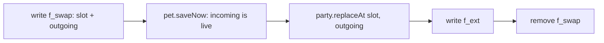

# Party follower switching (fork-only)

## Rules decided

- **Level is still age.** Only the active follower ages, evolves and drains. Party and box members stay frozen at their level. Battles keep giving only training and badges. Party members already freeze this way, so the only new part is the swap itself.
- **Switching needs a hatched follower.** While an egg is waiting, the party sheet's left button stays upstream's BRING BACK, unchanged, so `release_test` stays green. When the follower is hatched, the same button becomes SWITCH.
- **The party is at most 6, and the follower counts as one of them.** That leaves at most 5 banked members. The live slot always counts, whether it holds an egg or a creature, the same way an egg counts in the main games. The header reads `party.count() + 1` out of 6.
- **Switching is one-for-one.** The outgoing follower takes the incoming member's party slot, so the cap can never be broken by a switch.
- **The box exchange stays as it is,** with the cap applied. TO PARTY, a grid swap and a farewell's party-then-box fallthrough all see the party as full at 5 banked members. The follower is not a box candidate directly: switch it out into the party first, and it can then be deposited like any other member.
- **Switching is not allowed** during a ceremony, during the evolution animation, while the starter is still being picked, or while a move-learn offer is pending. A pending offer lives only in RAM, in `learnQueue`, and would be lost. Switching IS allowed while the follower is asleep; the incoming creature arrives awake.
- **The incoming creature always grows.** Switching in clears `frozen`, so a legacy BRING BACK companion that is switched out and back starts ageing normally. This goes in `FORK.md`.
- **Farewell is prompted only once per creature.** The first time a creature meets the current requirements (final form and at least `FAREWELL_AGE_MIN`, 3 days of its own age), the farewell offer pops up as it does today, including right after it is switched in. If the player declines, it is never auto-prompted again for that creature. This replaces upstream's re-offer every 24 hours.
- **After that, farewell is on the details page.** Whenever `canFarewellNow()` holds, the creature's details sheet shows a FAREWELL button that starts the same ceremony, with the same banking and blessing. It is hidden until the requirements are met. See "Farewell prompted once" below.

## Fork strategy

The same rules as [wild_pokemon_battles_c1ae448a.plan.md](.cursor/plans/wild_pokemon_battles_c1ae448a.plan.md):

- New code goes in new files, and upstream files get only one-line hooks tagged `// FORK(follow)`.
- New NVS keys carry the `f_` prefix.
- No edits to README, CLAUDE.md, `FW_VERSION` or upstream tests.
- Branch: `pt/follow-switch`, off the fork's `main`.

## Enforcing the 6-member cap

Storage keeps `PARTY_SLOTS` at 6. Shrinking it to 5 would make the length-based migration in `Party::begin()` read a 180-byte blob as 36-byte records and scramble the party. Instead, slot index 5 becomes reserved, and the cap lives in one place:

- **One rule, read by every caller.** `party.h` gets `#define PARTY_CAP (PARTY_SLOTS - 1)`, and `Party::firstFree()` and `isFull()` loop to `PARTY_CAP`.
  - Every path that adds to the party goes through those two functions: the farewell bank (`TamaPoke.ino:771`), the serial `PARTY <dex>` command, the box sheet's TO PARTY (lines 1286 and 5315), and the box's party-is-full check (5354).
  - Checked against the upstream tests: `box_test`'s add, fallthrough and `firstFree` cases give the same answers at a cap of 5. The tests that seed six members write `slots[]` directly, so they still load and count six.
- **Grid cell 6 shows the follower.** After the slot loop in `renderParty()`, `followDrawCell()` draws the live creature or egg in cell 5, with a FOLLOWING tag.
- **Taps on cell 6 are taken first.** `followCellTap(x, y)` runs before the slot loop in `partyTap()` and swallows them. That one guard covers every way of filling slot 5: dropping a box creature there (`boxSel`), the replace picker shown when both party and box are full (`partyPick`), and arming a swap from that cell (`boxSwapFrom`).
- **Legacy saves holding 6 banked members** are fixed once, in `followLoad()`. If `slots[5]` is occupied:
  - it moves to the first free slot among 0-4
  - if there is none, it goes into the box
  - the copy is written before the slot is cleared, and a fingerprint check skips the copy if one already exists, so a crash between the two steps can neither duplicate nor lose it

  If the party AND the box are both full, it stays where it is. While `slots[5]` is occupied, `followDrawCell` and `followCellTap` stand aside, so the creature stays visible and can be deposited or released. Nothing is ever hidden or deleted.
- **The battle picker is unchanged.** `pickCandidates()` still loops all 6 slots. Slot 5 is empty in normal play, and `touch_test`'s "7 candidates" seed keeps passing.

## Saving care state across a switch

`PartyMon` keeps its shape (30 bytes). Changing it would move the stride of both the party and box blobs. The care state that `PartyMon` cannot hold goes under a new additive key, `f_ext`:

- **What it stores.** A fixed array of 8 `FollowExt` records, 28 bytes each, 224 bytes in total. That stays under `MAX_VAL` (768) in [save.cpp](save.cpp).
- **Fields in each record:**
  - a 32-bit fingerprint
  - `ageMinutes`
  - `farDeclinedAge`
  - fullness, joy, energy, hygiene
  - poops and weight
  - bond
  - `careMistakes`, `mistakeCooldown` and `neglectTicks`
  - `evoPen`, `evoDeclinedLv` and `lastLearnLevel`
  - `berryKnown`
  - `goodTicks`
- **How a record is matched.** Records are found by content, not by slot position. The fingerprint is an FNV-1a hash over dex, level, medals, IVs, training, shiny and nick, and is never 0.
  - Moves are left out of the hash, because they can be edited on a banked creature.
  - Matching by content means moves through the box, reorders and releases need no hooks.
- **Pruning and eviction.** When saving, records whose fingerprint matches no party or box member are dropped. If all 8 records are in use, the oldest is evicted.
- **A missing record degrades gracefully.** The creature comes in as `reviveFrom()` builds it today:
  - its age is derived from its level, `(level - 1) * 60`
  - `lastLearnLevel` is set to its current level
  - its care stats are fresh

A crash mid-swap must not duplicate or lose a creature. A transient journal key, `f_swap`, makes the swap atomic. It holds the slot and the outgoing `PartyMon`:

At boot, `followLoad()` checks for a leftover `f_swap`:

- If the live pet's fingerprint matches the incoming creature, the pet was already saved, so it finishes the `replaceAt` step.
- Otherwise the swap never took effect, so it just deletes the journal.
- In both cases nothing is written when there is no journal.

## New files

- [follow.h](follow.h) / [follow.cpp](follow.cpp). These have no dependency on the sketch, so they link into tests the same way `pet.cpp` does.
  - `struct FollowIO` is declared as a friend of `Pet`, so it can read and write private fields such as `goodTicks`, `evoPen` and `neglectTicks` without refactoring `Pet`.
  - `followFingerprint(const PartyMon&)`, and `followSnapshot(const Pet&)`, which returns a `PartyMon` plus a `FollowExt`.
  - `followCanSwitch(slot, &reasonId)` is the single answer used by drawing, tapping and the serial command.
  - `followSwitch(slot)` runs the journalled sequence above.
  - `followLoad()` and `followSave()` handle `f_ext` and journal recovery.
  - `FT(FollowStr)` is its own string table: `[LANG_COUNT][F_COUNT]`, read through `gLang`, ASCII only. Strings: SWITCH, LEARN THE MOVE FIRST, NOT NOW.
  - `followSerial(line)`: `FOLLOW` prints the ext records, and `FOLLOW <1-6>` switches.

## Hooks in upstream files, each tagged FORK(follow)

- [pet.h](pet.h): `friend struct FollowIO;` in the private section.
- [party.h](party.h) / [party.cpp](party.cpp): add `PARTY_CAP`, and loop `firstFree()` and `isFull()` to it.
- [TamaPoke.ino](TamaPoke.ino):
  - Add `#include "follow.h"`, and call `followLoad();` right after `party.begin(); pet.begin();` (lines 687-688).
  - In `renderMonSheet()` (lines 1285-1287 and 1316): when `!fromBox && !pet.isEgg()`, draw the label, enabled state and greyed-out reason from `followCanSwitch()` / `FT()`. Otherwise keep upstream's expression.
  - In `partyTap()` (line 1460): before the BRING BACK branch, add `if (!pet.isEgg() && followTapSwitch(partyDetail - 1)) return;`.
    - `followTapSwitch` closes the sheet and the party and plays `SFX_HATCH` on success, or `SFX_DENY` if refused.
    - The sprite reloads by itself through `ensureMon()`, which keys off `speciesId` and `shiny`.
  - In `renderParty()` (line 5412): show `party.count() + 1` in the header. After the slot loop (line 5456), call `followDrawCell();`.
  - In `partyTap()`: `if (followCellTap(x, y)) return;` just before the slot loop (line 1508).
  - In `handleSerial()`: `if (followSerial(line)) return;`.
- [save.cpp](save.cpp): append `{ "f_ext", SK_BYTES }`. `f_swap` is deliberately left out, because a backup must not replay a half-finished swap.
- [tools/emu/build.sh](tools/emu/build.sh) and [tools/emu/tests/run.sh](tools/emu/tests/run.sh): add `follow.cpp`, and add `follow_ui_test` to `needs_sketch`.

## Farewell prompted once

- **No new field.** `farDeclinedAge` already means "don't offer before this age". Declining sets it to a sentinel, `FAREWELL_NEVER` (`UINT32_MAX`), instead of `ageMinutes + 1440`, so `wantFarewellButton()` never fires the prompt again. This is a single `FORK(follow)` hook in `Pet::declineFarewell()` (`pet.h:338`). Saves stay compatible: upstream reads the sentinel as "not yet" and simply never re-offers.
- **Survives switching.** `farDeclinedAge` is already in `FollowExt`, so a creature switched out and back in keeps its "already prompted" state. A creature with no ext record falls back to 0 and may be prompted once more, which is acceptable.
- **The manual button.** `renderMonSheet()` for the live follower gets a FAREWELL button, drawn by `followDrawFarewell()` and tapped through `followTapFarewell()`, visible only when `canFarewellNow()` is true. It calls the existing `startFarewell()`. Banked party and box members do not get it, because they are frozen and their farewell happens by switching them in.
- **New string:** `FT(F_FAREWELL)`, ASCII in all 6 languages.
- **Tests (in `follow_test` / `follow_ui_test`):** the prompt fires once on reaching the requirements; after declining, 2 weeks of ticks never prompt again; the sheet button is hidden before the requirements and shown after; tapping it starts `CER_FAREWELL` and banks the creature exactly like the prompt does. Negative check: restore the 1440 re-offer and the "never again" test must fail.

## Tests

These are new, fresh-harness suites. Each guard is negative-checked: break it on purpose and watch the test fail.

`follow_test`:

- **Round trip.** Switch A out for B, tick B, then switch A back. A's exact `ageMinutes`, bond, stats, mistakes, moves, nick and IVs come back unchanged. Negative check: skip the ext restore and the test must fail.
- **Frozen while banked.** Run 600 live ticks plus a 2-week `syncClock`. The party member's level and ext record do not change, while the follower's age does.
- **Refusals:** an egg, a ceremony, a pending learn offer, an empty slot, and while the starter is being picked. Each one has a companion check proving that a valid switch does go through.
- **A missing or evicted record** falls back to an age derived from the level. A content match survives the member going to the box and back, and having its moves edited.
- **Legacy frozen companion.** A `frozen` follower switched out and back in has `frozen == false`.
- **Journal recovery,** for both crash points: no duplicate and no loss. With no journal, boot writes nothing.
- **Backup.** `EXPORT` with a full party, a full box and 8 ext records is not truncated by `saveExportSize()`, and `IMPORT` restores `f_ext`.
- **Strings.** Every `FT()` string is non-null and ASCII in all 6 languages.
- **The cap.**
  - With 5 banked members, `add()` falls through to the box, and box TO PARTY is refused.
  - With 4, both succeed.
  - Negative check: put the loop bound back to `PARTY_SLOTS` and these must fail.
- **Legacy six.** Seed six banked members:
  - with a hole in slots 0-4, the sixth moves there
  - with no hole, it goes to the box
  - with the party AND the box full, it stays in place
  - a crash between the copy and the clear leaves exactly one copy after the next boot

  In every case the total number of creatures is unchanged.

`follow_ui_test`:

- The sheet's SWITCH button flushes, is drawn greyed with its reason when refused, and switches when tapped at the panel centre.
- After a switch the party sheet is closed, and `uiCurrentScreen() == SCR_MAIN`.
- **The header and the follower cell.** The header reads `N/6` with the follower counted, and cell 6 draws the follower.
- **Cell 6 cannot be filled.** Tapping it with a box creature selected (`boxSel`), with the replace picker up (`partyPick`), or to arm a swap leaves `slots[5]` empty. Each case has a companion check showing the same action does work on cell 1.

All 34 existing suites must pass unchanged, `release_test`'s BRING BACK check included.

## Docs

Create or append [FORK.md](FORK.md) with:

- the switching rules
- the 6-member cap with the follower counted, the reserved slot 5, and the one-time move of a legacy sixth member
- the `f_ext` and `f_swap` keys and their upgrade safety: absent keys mean no writes, a short blob reads into the front, a long one is truncated
- the eviction behaviour
- every FORK(follow) hook
- the note on legacy frozen companions
- the farewell-once rule and the details-page FAREWELL button

