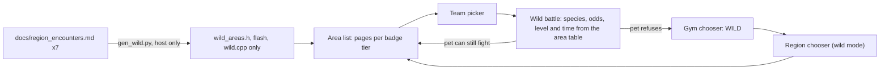

# Wild encounter areas, driven by the region encounter documents

This supersedes the "Gameplay" section of [.cursor/plans/wild_pokemon_battles_c1ae448a.plan.md](.cursor/plans/wild_pokemon_battles_c1ae448a.plan.md) **for every region**. All seven entries in `dex_data.py`'s `REGIONS` have a document, so the generator requires one per region and the random roll is retired (section 2). A future region ships its `.md` together with its ladder; nothing in the firmware lists regions.

The fork rules from that plan still apply:

- New code goes in new files.
- Upstream files only get one-line hooks tagged `// FORK(wild)`.
- Strings stay in the fork's `W_STRINGS` table.
- README, CLAUDE.md and `FW_VERSION` are not edited.

## Flow

## 1. Data: the .md files, compiled by a generator

**The source is the Markdown files only:** [kanto](docs/kanto_region_pokemon_encounters.md), [johto](docs/johto_region_pokemon_encounters.md), [hoenn](docs/hoenn_region_pokemon_encounters.md), [sinnoh](docs/sinnoh_region_pokemon_encounters.md), [unova](docs/unova_region_pokemon_encounters.md), [kalos](docs/kalos_region_pokemon_encounters.md), [alola](docs/alola_region_pokemon_encounters.md).

There is no JSON. Delete the untracked, half-finished `docs/kanto_region_pokemon_encounters.json`; storing the data twice would mean keeping two copies in sync forever.

### The format contract (record it in `FORK.md`)

- A section is a `## N. Heading`. It may hold several tables; `### ...` subheadings inside it (Unova's BW / B2W2, Alola's SM / USUM) are ignored and their tables belong to the section.
- An encounter table's header has four columns whose names start with `Pok`, `Location`, `Level` and `Encounter` (so Alola's "Encounter Rate / Notes" matches). The separator row is any mix of `-` and `:` per cell (`:---` and `-----` both occur).
- An `**Available Areas...:**` line (optionally tagged, e.g. `(BW)`, with a trailing period allowed) lists the places a section covers. A section may have several.
- Editing the docs is safe as long as that layout stays. Anything the parser cannot read fails the build; nothing is silently skipped.

**Regions and gyms come from the code, never from a list in the script** (CLAUDE.md trap 2)

- Each `REGIONS` entry in `dex_data.py` maps to `docs/<name lowercased>_region_pokemon_encounters.md`. A missing document fails, and so does a document that maps to no region.
- The ladder comes from [trainers.h](trainers.h): parse `TRAINER_SETS` for each region's array, read `TRAINER_GYMS`, and take the first `TRAINER_GYMS` `{ "NAME", "PLACE", ...` rows of that array. A region with no `TRAINER_SETS` entry fails.

### Sections and tiers

Every section must be exactly one of the following, or the build fails. That way a misspelled leader name fails instead of silently skipping a whole tier.

- **Gym-named:** the heading names at least one of the region's first `TRAINER_GYMS` trainers. Matching is a word prefix on the normalized heading, so "Lt. Surge" matches `LT SURGE`, "Crasher Wake" matches `WAKE`, and Alola's "Ilima's Trial" matches `ILIMA`. Only gym trainers count, so Hoenn's "Wallace / Juan" resolves to `JUAN` (Wallace is the champion) and Alola's kahunas Hala, Olivia and Acerola, who are Elite 4, are ignored. The tier is (index of the earliest-in-ladder named trainer) + 1.
- **`SECTION_TIER`**: an explicit tier, used where the rule above gives the wrong answer.
- **`TIER_TITLES`**: the pre-Elite 4 tier `TRAINER_GYMS + 1`, with the given title.
- **`SKIP_SECTIONS`**: legendaries, post-game, gifts and trades. Skipped sections are never parsed, apart from their Available Areas lines, which feed the known set.

Tiers of non-skipped sections must strictly increase in document order, and **tier 1 must own at least one area**, or the region opens with nothing playable at 0 badges.

| region | sections -> tiers | overrides |
|---|---|---|
| Kanto | 1-8 -> 1-8 (Victory Road is in Giovanni's, 8) | skip 9, 10 |
| Johto | 1-8 -> 1-8, 9 -> 9 | `TIER_TITLES` 9 `VICTORY ROAD`; skip 10 |
| Hoenn | 1-8 -> 1-8, 9 -> 9 | `TIER_TITLES` 9 `VICTORY ROAD`; skip 10, 11 |
| Sinnoh | 1->1, 2->2, 3 (Fantina / Maylene) -> 3, 4 (Wake) -> 5, 5->6, 6->7, 7->8, 8 -> 9 | `TIER_TITLES` 8 `VICTORY ROAD`; skip 9, 10. Tier 4 owns no section |
| Unova | 1 -> 1, 2 (Burgh) -> 3, 3->4, 4->5, 5->6, 6 -> 7, 7 -> 9 | `SECTION_TIER` 1 -> 1 (it names Roxie, not Cheren, and tier 1 would be empty), 6 -> 7 (it names Roxie, Drayden and Marlon; Roxie would break monotonicity); `TIER_TITLES` 7 `VICTORY ROAD`; skip 8, 9 |
| Kalos | 1-8 -> 1-8, 9 -> 9 | `TIER_TITLES` 9 `VICTORY ROAD`; skip 10, 11 |
| Alola | 1 (Ilima) -> 1, 2 (Lana, Kiawe, Mallow) -> 2, 3 (Sophocles, Nanu) -> 5, 4 (Mina, Hapu) -> 6 | skip 5, 6. No pre-Elite 4 tier |

- A gym tier's title is that trainer's `place` (`PEWTER`, `HEARTHOME`, `MELEMELE`); no heading text is used for it.
- Tier k opens once gym k-1 is beaten; tier `TRAINER_GYMS + 1` opens with all eight.
- **Both versions are kept.** Unova's BW and B2W2 subtables and Alola's SM and USUM subtables are all parsed, exactly as version exclusives are kept: a device has no game version. Unova's ladder is B2W2, so BW-only places (Dreamyard, Pinwheel Forest, Cold Storage, Route 10) are an accepted mix, recorded in `FORK.md`.

### Rows: fix, skip, then parse

1. **`ROW_FIX`** replaces a raw row with one or more rows, keyed by `(region, section, raw Pokemon cell)`. It is for rows a rule cannot express. Each entry must match exactly one row.
2. **`RARITY`** replaces a raw rarity cell by exact text, per region.
3. **Skip** (printed in the report with the reason):
   - the rarity contains, as a word, `Static`, `Story`, `Special`, `Gift`, `Roaming` or `Event`. That catches Red Gyarados, every box legendary, Cherubi's honey trees, Drifloon, Rotom, Abomasnow, Zorua's gift, Crustle's "Overworld / Static Encounter" and Unova's elemental monkeys.
   - any species in the row is legendary (Raikou / Entei).
   A skipped row is never parsed further: Lugia's `45 / 70` and "Johto Grass (Roaming)" must not fail the build on rows that were about to be dropped.
4. **Parse** what remains (below).

### Names

- Remove `**`. Split the cell on ` / ` **at parenthesis depth 0 only**, so "Lycanroc (Midday / Midnight)" stays one name.
- Italic groups `*(...)*` on a name: if the group is made only of time words (see Time), it is **that species'** time note ("Yungoos *(Day)* / Rattata (Alolan) *(Night)*"). Any other italic group is a version tag and is dropped ("Throh *(White)*", "Solosis *(Re-encounters)*").
- Match the `dex_data.py` slug after lowercasing and dropping everything but letters and digits ("Nidoran (F)" -> `nidoranf`, "Mime Jr." -> `mimejr`, "Jangmo-o" -> `jangmoo`, "Flabébé" -> `flabebe` after NFKD). If that misses, retry with the parenthesised text removed, so regional forms collapse to their species ("Rattata (Alolan)" -> `rattata`, "Oricorio (Pom-Pom Style)" -> `oricorio`). Every collapse is logged. An Alolan form is the Kanto species and needs the Kanto pack.
- **`NAMES`** fixes document typos before matching (a raw name -> a slug, or `None` to drop it): Unova `Grimimer` -> `grimer` and `Turtouga` -> `None` (it duplicates Tirtouga in the same row); Kalos `Skrepler` -> `skrelp`; Alola `Belum` -> `beldum`.
- **Art-less species are dropped** at generation, logged, by reading `NO_ART` from `noart.h`; the list is derived, never restated. That drops Zebstrika, Shelmet, Bouffalant, Tirtouga, Throh, Blitzle, Amoonguss, Oricorio, Trumbeak and Oranguru. A row emptied this way is dropped and logged, not failed: art arrives upstream over time. Re-run the generator after `check_sprites.py --emit`; `--check` fails until you do.
- An unknown name fails.

### Levels

"2–5" (en dash or hyphen) or a single "12", which sets `lo = hi`. Anything else, such as Turtonator's "26–30 / 42–46", fails unless `ROW_FIX` rewrites it.

### Text normalization

Transliterate, never delete: NFKD and drop combining marks ("Pokémon Tower" -> `POKEMON TOWER`, "Détourner" -> `DETOURNER`). Then uppercase and drop punctuation, both apostrophes included: "Mt. Moon" -> `MT MOON`, "Dragon's Den" -> `DRAGONS DEN`, "Hau'oli City" -> `HAUOLI CITY`.

### Locations

- Look the whole cell up in `ALIASES` first. Otherwise split it on `,` and ` / ` **at parenthesis depth 0 only**: "Underwater (Dive on Routes 124, 126)" stays whole, and "Wellspring/Chargestone" (no spaces) is not split.
- For each piece, look it up in `ALIASES`, then drop its parenthesised text, then normalize.
- A bare number continues the previous piece's prefix: "Route 29, 30, 31" gives Routes 29, 30 and 31. "Routes" becomes "Route".
- **The known set** is the union of every Available Areas line (skipped sections included, split and aliased the same way), the targets of `ALIASES`, and `EXTRA_AREAS`. A location outside it fails, which catches typos.
- A row whose locations all drop away fails; it would be a species with nowhere to appear. This is distinct from a row emptied by the art-less drop.

### Time tags

- Time words: `Morning`, `Day`, `Daytime`, `Night`. A time note is a parenthesised group made only of time words joined by `/`, optionally followed by a percentage: "(Morning/Day)", "(Night 10%)", "(Morning/Night)". It can sit in the rarity cell, where it applies to every species in the row, or on a name as above. "(Winter 30%)" and "(Yellow/Red/Orange flowers)" are not time notes.
- Masks: Morning = M, Day = D, Daytime = M|D, Night = N. **`TIME_WORDS`** overrides that per region. Alola: Day = M|D, because Sun/Moon has only day and night.
- **`PAIRED_TIMES`**: rows whose time note pairs with the species in order. Johto: "Meowth / Farfetch'd (Night/Day)". This is an override, not a general rule, so a future two-species row tagged "Morning/Day" is never mis-paired silently.
- A row with no note is available at any time. Seasons ("Winter") and swarms are not modelled.

### Evolution pairs: only the evolved form is clamped

Within a row, wherever one species is the other's `evolvesTo` in `dex_data.py`, in either order (Kalos and Unova write "Mantine / Mantyke"):

- The evolved form B is clamped to `max(lo, B's evolveLevel) .. hi`. If that is empty, B is dropped and logged, and the base form keeps the row's whole weight.
- **The base form keeps the full range.** An unevolved creature above its evolution level is reachable in this game, because care mistakes delay evolution. Clamping the base would delete Voltorb from the Power Plant, Mareep from Routes 42/43 and Pidgeotto from Route 23.
- Where both survive, they split the row's weight evenly. So do non-evolution splits (Caterpie / Weedle, Pinsir / Scyther, Ariados / Banette / Dusclops).
- **Scope of the guarantee:** inside a pair, the evolved form never appears below its own evolution level. Single-species rows keep the document's levels as written: Kanto's Metapod 4-6 and Pidgeotto 13-17, Hoenn's Claydol 34-38. Recorded as a known limit.

### Weights, in tenths of a percent

- `uint16_t`, floored at 1.
- Take the first percentage in the rarity, or the midpoint of a range: "Very Rare (1% / Swarm 40%)" -> 10, "Common (20% in grass / 70%-100% in cave)" -> 200.
- With no percentage, the first keyword that matches decides, in this order: Very or Extremely Rare = 10, "Common to Uncommon" = 250, Uncommon = 150, Rare = 50, Common = 400. "Version Exclusive / Common" -> 400.
- If the rarity contains "each" ("Rare (4% each)"), every species gets the full weight instead of a share.
- No keyword fails, unless `RARITY` rewrites it.

### Overrides, per region, in `gen_wild.py`: the whole record of every judgement call

**Every entry must be used at least once, or the build fails.** A stale alias that silently matches nothing is the `str.replace` no-op from CLAUDE.md trap 3.

- `SECTION_TIER`, `TIER_TITLES`, `SKIP_SECTIONS`: the table above.
- `ALIASES` (a raw location -> area names; an empty list drops it):
  - Kanto: "Water Routes" -> [].
  - Johto: "Trade" -> [] (from "Route 39 / Trade").
  - Hoenn: "Sea Routes (Surf)" and "Surfing Routes" -> `ROUTE 105`, `ROUTE 108`. "Underwater (Dive on Routes 124, 126)" and "Underwater (Dive areas)" -> `ROUTE 124`, `ROUTE 126`. On Norman's Available Areas line, "All previous routes" -> [] and "plus Surf-accessible areas (...)" -> `ROUTE 105`, `ROUTE 108`, `ROUTE 115`, `ROUTE 118`. Its contents are at depth 1, so without the alias they would be stripped as parenthesised text.
  - Sinnoh: "Ruin Maniac Cave / Tunnel" -> `MANIAC TUNNEL`; "Snowpoint Temple" -> [] (post-game, and 16 characters); "Canalave City (Surf)" -> [].
  - Unova: "Wellspring/Chargestone (Dust Clouds)" -> `CHARGESTONE CAVE`.
  - Kalos: "Cyllage / Ambrette / Azure Bay (Old Rod)" -> `AZURE BAY`.
  - Alola: "Poni Breaker Coast" -> [].
- `EXTRA_AREAS` (real places the Available Areas lines omit):
  - Johto `AZALEA TOWN`
  - Sinnoh `OLD CHATEAU`, `TROPHY GARDEN`
  - Unova `ROUTE 16`, `MISTRALTON CAVE`
  - Alola `HAUOLI CEMETERY`, `MOUNT LANAKILA`
- `DISPLAY` (the area's identity is unchanged; only its label is shortened to `WILD_NAME_MAX`):
  - Sinnoh: `VALLEY WINDWORKS` -> `WINDWORKS`, `ACUITY LAKEFRONT` -> `ACUITY SHORE`
  - Unova: `CASTELIA GARDENS` -> `CASTELIA PARK`, `DRIFTVEIL DRAWBRIDGE` -> `DRAWBRIDGE`, `CHARGESTONE CAVE` -> `CHARGESTONE`, `REVERSAL MOUNTAIN` -> `REVERSAL MTN`, `DRAGONSPIRAL TOWER` -> `DRAGONSPIRAL`
  - Kalos: `SANTALUNE FOREST` -> `SANTALUNE WOODS`
  - Alola: `WELA VOLCANO PARK` -> `WELA VOLCANO`, `THRIFTY MEGAMART` -> `MEGAMART`, `EXEGGUTOR ISLAND` -> `EXEGGUTOR ISLE`, `ANCIENT PONI PATH` -> `ANCIENT PATH`, `VAST PONI CANYON` -> `PONI CANYON`
- `RARITY` (exact raw text -> replacement):
  - Hoenn: "Static / Uncommon" -> "Uncommon" (Kecleon)
  - Sinnoh: "Daily Marsh Encounter" -> "Uncommon", "Version Dependent" -> "Common"
  - Kalos: "Horde Encounter" -> "Common", "Rock Smash" -> "Uncommon"
  - Alola: "Overworld Chaser" -> "Uncommon", "Fishing Encounter" -> "Common", "Weather SOS Only (Sandstorm)" -> "Rare", "SOS Encounter from Haunter" -> "Rare", "SOS Encounter from Jangmo-o" -> "Rare"
- `ROW_FIX`:
  - Sinnoh §3 "Geodude / Hippopotas": Geodude "Common" and Hippopotas "Rare (5%-10%)" as two rows.
  - Sinnoh §6 "Noctowl": rate "Common (Night)" (the note sits in its location cell, which is stripped).
  - Alola §3 "Shuppet / Mimikyu": Shuppet "Common" and Mimikyu "Very Rare (5%)".
  - Alola §4 "Turtonator": Blush Mountain 26-30 and Mount Lanakila 42-46 as two rows.
- `NAMES`, `TIME_WORDS`, `PAIRED_TIMES`: above.

### Building the table

- **Slot tier** = its row's section tier.
- **Area tier** = max(the tier of the earliest *tier* section whose Available Areas lists the area, the earliest slot tier). An area that is listed nowhere (an `EXTRA_AREAS` place or an alias target) uses the earliest slot tier.
  - Listings in skipped sections do not count towards the tier.
  - An area exists only where slots do, so Pokeathlon Dome, Olivine Harbor, Routes 129-134 and Sunyshore City never become areas.
  - This puts an area where the document says the player reaches it. A row from an earlier tier that also names a later place (Kanto's Mankey on Routes 5 and 6, Kalos' Sliggoo on Route 19) adds a slot to that area without opening it early.
- **Effective gating:** a slot is live when both its area's tier and its own tier are unlocked. Because area tier >= the earliest slot tier, an unlocked area always has a tier-live slot.
- **Duplicates:** two slots with the same `(area, dex, lo, hi, tmask)` merge, keeping the lower tier and the higher weight, and the merge is logged (Jasmine's Magnemite repeats Chuck's).
- **Name length:** a display name or tier title longer than `WILD_NAME_MAX` (15) fails. It is emitted into the header, and `wild_ui.h` asserts it fits the row.

### Output: `wild_areas.h`, included by `wild.cpp` only

- `WILD_AREAS[]`: `{ uint8_t region, tier; const char *name }` (the display name), sorted by `(region, tier, first appearance)`.
- `WILD_SLOTS[]`: `{ uint16_t area; int16_t dex; uint16_t weight; uint8_t tier, lo, hi, tmask }`.
- `WILD_TIERS[]`: `{ uint8_t region, tier; const char *title }`.
- `WILD_REGION_SLOTS[REGION_COUNT]` and `WILD_REGION_AREAS[REGION_COUNT]`: `{ uint16_t first, count }`. `REGION_ALL` is `{0, 0}`.
- `#define WILD_NAME_MAX 15`, plus `WILD_TM_MORNING 1`, `WILD_TM_DAY 2`, `WILD_TM_NIGHT 4`, `WILD_TM_ALL 7`.
- Only `wild.cpp` includes it; a `static const` table included from two translation units is compiled into flash twice. The sketch and the tests reach it through the accessors in section 2.

### The script fails on

- a missing document, a document with no region, or a region with no ladder
- an unclassified section, non-monotonic tiers, or an empty tier 1
- an unknown name, location, rarity word, time note or level form
- a row whose locations all drop away
- a level outside 1..100, or `lo > hi`
- a display name longer than `WILD_NAME_MAX`
- an override entry that matched nothing
- a table larger than 24 KB

**The report:** every run prints, per region, the areas per tier with their slot counts, and every skipped row, form collapse, art-less drop, evolution clamp and dropped half, merge and override use, plus the table's size in bytes.

**`--check`** regenerates in memory and diffs against the committed header. **`--selftest`** runs the fixtures in section 6 against temporary copies of the documents.

### Expected outcomes, so the review can check the report against them

- **Kanto:**
  - `ROUTE 5` and `ROUTE 6` open at tier 3; Misty's Mankey is a tier-2 slot inside them. `ROUTE 8` opens at tier 4.
  - `ROUTE 22` opens at tier 1; its Nidoran slots are tier 2.
  - The Power Plant keeps Voltorb 30-35 next to Electrode 30-35. Route 23 keeps Pidgeotto 39-43 next to Pidgeot 39-43.
  - Arbok, Sandslash, Persian, Primeape, Muk, Weezing and Venomoth drop out (each evolves above its row's top level).
  - Tentacruel 30-40, Magneton 30-33.
- **Johto:**
  - `ILEX FOREST` opens at tier 3. `ROUTE 45` opens at tier 9, with Skarmory (a tier-5 slot), Phanpy and Teddiursa.
  - Lake of Rage: Magikarp 10-30, Gyarados 20-30. Routes 42/43 keep Mareep 15-17 next to Flaaffy.
  - No Golbat in Slowpoke Well, Union Cave or Burned Tower; no Dragonair in Dragon's Den. Routes 26 and 27 get no area.
- **Hoenn:**
  - Tier 1 has 7 areas. `ROUTE 114` opens at tier 4 (Lotad and Seedot are tier-1 slots inside it), `ROUTE 105`/`ROUTE 108` at 5, `ROUTE 119`/`ROUTE 120` at 6, `ROUTE 123` at 7 and `ROUTE 126` at 8.
  - Feebas has weight 10, Whismur 200.
  - Routes 109 and 122, New Mauville and the Abandoned Ship get no area.
- **Sinnoh:**
  - Tier 4 (Maylene) owns no areas. `GREAT MARSH` and `ROUTE 212` open at tier 5; Ralts / Kirlia and Roselia are tier-3 slots in Route 212.
  - `ROUTE 223` opens at tier 9, carrying Volkner-tier slots. `OLD CHATEAU` opens at tier 2.
  - Cherubi, Drifloon, Rotom and every lake guardian are skipped.
- **Unova:**
  - Tier 1 holds both versions' early areas (Routes 1, 2, 19, 20, Dreamyard, Floccesy Ranch, Virbank Complex). Tiers 2 and 8 own nothing.
  - The six art-less species are dropped; Crustle and Zorua are skipped.
- **Kalos:**
  - `ROUTE 19` opens at tier 8, with Sliggoo 46-48 as a tier-6 slot inside. `ROUTE 8` opens at tier 2 and gains Skrelp and Clauncher at tier 7.
  - Amoonguss and Shelmet are dropped. Tier 9 is `VICTORY ROAD`.
- **Alola:**
  - Only tiers 1, 2, 5 and 6 own areas. Routes 1-3 give Yungoos by day and Rattata by night.
  - Kommo-o drops out (it evolves at 45; the row stops at 44). `MOUNT LANAKILA` opens at tier 5.
  - Turtonator is 26-30 on `BLUSH MOUNTAIN` and 42-46 on `MOUNT LANAKILA`.

### Memory

- The firmware never reads the Markdown files. Nothing is parsed on the device and nothing is loaded from SD.
- Every emitted array is `static const` with `const char*` literals, so it lives in flash. Estimate: about 900 slots at 10 bytes, plus about 250 areas and their names, around 15 KB against a 3 MB app partition that is 52% full.
- **No candidate buffers:** `wildRollArea`, `wildAreaOpen` and `wildAreaLevels` use `pickTier()`'s count-then-pick pattern over the area's slots only. Slot and area indices are `uint16_t`.

## 2. Logic in [wild.h](wild.h) / [wild.cpp](wild.cpp)

**Accessors** (the only way the sketch and tests see the table):

- `uint16_t wildAreaCount(uint8_t r)`, `uint16_t wildAreaFirst(uint8_t r)`. Areas are addressed by a global `uint16_t` index.
- `const char *wildAreaName(uint16_t a)`, `uint8_t wildAreaTier(uint16_t a)`, `uint8_t wildAreaRegion(uint16_t a)`.
- `const char *wildTierTitle(uint8_t r, uint8_t tier)`.
- For the tests: `uint16_t wildSlotCount(uint16_t a)` and `bool wildSlotAt(uint16_t a, uint16_t i, WildSlotView &out)`.
- `#define WILD_NO_AREA 0xFFFF`.

**Rules:**

- `bool wildRegionHasAreas(uint8_t r)`: `WILD_REGION_AREAS[r].count > 0`. Derived from the table.
- `uint8_t wildTier(const Pet&, uint8_t r)`: 1 plus the **longer** of the two consecutive-badge runs from gym 0, one over `badgeMask(r, false)` and one over `badgeMask(r, true)`, each counting only the first `TRAINER_GYMS` bits. Range `1..TRAINER_GYMS + 1`.
  - Separate runs are what make it match `gymUnlocked()`, which is per difficulty. OR-ing the masks would build a run neither ladder has.
  - The cap matters because the masks also carry the Elite 4 and the Champion in bits 8-12.
- `int8_t wildHour(const Pet&)`: `(lastSeenEpoch / 3600) % 24`, the same formula and source as `isNightHour()` (the sketch refreshes `lastSeenEpoch` from the RTC), or -1 when `lastSeenEpoch == 0`. Written once, in `wild.cpp`, and used by everything below.
- `uint8_t wildTimeMask(const Pet&)`: one bit from the hour, with HGSS windows as `#define`s in `wild.h`: morning 04-10, day 10-20, night 20-04. The same windows apply to every region (Gen 4 uses them too; Alola's day/night is approximated through `TIME_WORDS`). An hour of -1 gives `WILD_TM_ALL`. That only happens on a fresh save or in the emulator; a board whose RTC was never set reads a wrong but non-zero time, so its gating is wrong rather than open. Accepted, and recorded.
- A slot is **live** when its area tier and its own tier are both `<= wildTier`, `tmask & wildTimeMask`, and `wildPlayable(dex)` holds. The last covers region packs, so a Johto area full of Kanto species needs the Kanto pack.
- `bool wildAreaOpen(const Pet&, uint16_t a)`: at least one slot is live.
- `WildRefusal wildAreaWhyClosed(const Pet&, uint16_t a)`: filters applied in sequence.
  - The area tier is locked: `WILD_AREA_LOCKED`.
  - Otherwise, no slot that passes the tier filters passes the time filter: `WILD_AREA_NOT_NOW`.
  - Otherwise, no slot that passes both of those is playable: `WILD_LOCKED` (needs a pack).
  - So "the tier-live slots are all night-only" reads Not now, never Badge.
- `int16_t wildRollArea(const Pet&, uint16_t a, uint8_t &lvl)`: a weighted pick over the live slots, then `lvl = lo + random(hi - lo + 1)`. Returns -1 when nothing is live.
- `void wildAreaLevels(const Pet&, uint16_t a, uint8_t &lo, uint8_t &hi)`: the range over the live slots, for the row's subtitle.
- **`WildRefusal`** gains `WILD_AREA_LOCKED` and `WILD_AREA_NOT_NOW`, appended at the end. `wildRefusalText()` covers `WILD_AREA_NOT_NOW`. The badge reason needs a number, so the area screen formats `W_NEED_BADGE_FMT` itself.

**Retired:** `wildRoll()`, `wildEvolveFor()`, `wildLevelFor()`, `wildSquadTop()` and `WILD_COMMON_PCT`/`WILD_LEVEL_SPREAD`/`WILD_MIN_LEVEL`, with their `wild_test` sections. Every region now has areas, so no screen or command can reach them, and an untested path rots. `inRegion()`/`isWildBase()`/`pickTier()` go with them; the count-then-pick pattern lives on in `wildRollArea`.

**Unchanged:** energy cost, pet refusals and the seen bitmap.

**Reward: no training from foes far below you.** Area levels do not scale with the squad, so without a gate a level-73 team on Route 1 would bank training for `WILD_ENERGY_COST` at no risk.

- `wildReward(Pet&, bool won, bool petFought, uint8_t foeLvl, uint8_t &which)` returns 0 when `foeLvl + WILD_REWARD_GAP < p.level()`, with `WILD_REWARD_GAP 10`.
- The battle log then says `W_TOO_EASY`, because a win that silently trains nothing reads as a bug.
- Energy stays the rate limit, as for gym rematches.

## 3. Area screen in [wild_ui.h](wild_ui.h)

**State:** `wildAreasShown` (not `wildAreaOpen_`, which would differ from the predicate `wildAreaOpen()` by one underscore), `wildAreaPage`, `wildArea`.

- Invariant: `wildAreasShown` implies `gymOpen && gymPick && wildPickOpen`.
- **One exit function**, `wildExitToGyms()`, clears `wildAreasShown` and `wildPickOpen`. BACK on the region chooser, a pet refusal at FIGHT and a refusal after a battle all go through it, so a stale flag can never reopen the previous region's list on the next WILD tap.

**`wildRpickMode()` returns `0xFF` while `wildAreasShown`.** `rpickModeNow()` is the single answer to "which chooser is on the panel", and it maps `SCR_GYMPICK` to `wildRpickMode()`. Without this, `rpickSwipe`, `swipe_test` and anything else asking would believe the wild region chooser is up while the area list is showing.

**Geometry**, as `#define`s with `static_assert`s:

- Header: title and `PEWTER 1/2` at y 40-88. Six rows at `y = 96 + i * 46`, so the last row ends at 372, clear of BACK (y > 380). Rows are 46 high, at least `UI_TAP_MIN` (44).
- Each row spans x 63-403 (340 px). Both corners of the top and bottom rows lie inside the 233 px radius (half-chord about 187 px at y 96 and y 372).
- Name at text size 2 (`WILD_NAME_MAX` x 12 = 180 px). The right column is `Lv a-b` at size 2 (96 px), or a closed row's reason at size 1 (16 characters at most, 96 px). That totals 180 + 16 + 96 plus 2 x 16 padding = 324 px, which is 340 px or less.

**Pages:** each tier that owns areas gets `ceil(areas / 6)` pages, derived at runtime from the region's span of `WILD_AREAS`. Locked tiers are shown greyed, never hidden.

- It opens on the first page of the highest unlocked tier. Returning from a battle reopens the page the player left.
- A closed row is greyed with its reason: "Badge n", "Not now" or "Needs pack".

**Taps:** an open row sets `wildArea` and opens the team picker with `PICK_WILD`. A closed row plays `SFX_DENY`. BACK (y > 380) returns to the region chooser in wild mode.

**Swipes:** horizontal swipes page and never close; paging clamps at both ends. Vertical does nothing, as on every chooser (`onSwipeV` already returns on `SCR_GYMPICK`).

**Battle wiring:**

- `wildPickTap()`: a chosen region always opens the area screen. If a region ever has no areas, it is refused with `SFX_DENY` and logged; that path is unreachable while the generator requires a document per region.
- `WildRefusal startWildBattle(uint8_t region, uint16_t area)`: `WILD_OK` on success, otherwise the pet refusal, the area reason, or `WILD_NO_SQUAD`. The bool signature goes away, so `wildFight()` and `wildSerial()` route on one answer instead of re-deriving it.
- Refusal routing: a pet refusal (egg, asleep, too tired) goes through `wildExitToGyms()`, where the WILD button already says why. An area refusal (the hour rolled over while picking) returns to the area screen, where that row now reads "Not now".
- `wildAfterBattle()`: back to the area screen only if `wildPetRefusal() == WILD_OK`; otherwise `wildExitToGyms()`. A fight that leaves the pet too tired must not land on a list whose rows all look open but bounce at FIGHT.
- `wildPickBack()` from the team picker returns to the area screen.

**Serial:**

- `WILD AREAS [r]` is matched **before** the numeric forms. Today `sscanf("%d")` on `" AREAS"` fails, leaves `rg` at `pet.region`, and starts a fight. It lists each area as `<index> <name> tier=<t> <open | reason> Lv a-b`, with region-local indices.
- `WILD <r> <index>` fights in that area. Names contain spaces, so the index is the handle.
- `WILD <r>` picks a random open area, and `WILD` uses `pet.region`. With no open area it prints `refused: ` plus `W_NO_AREA`.

## 4. Hooks (each tagged `// FORK(wild)`)

Every symbol a hook uses is declared in [wild.h](wild.h): `extern bool wildAreasShown;`, `bool wildAreaSwipe(int)`, `void wildAreaTap(int16_t, int16_t)`, `void wildRenderAreas()`. The hooks sit above the `wild_ui.h` include, and the emulator's generated `proto.h` would hide a missing declaration that `arduino-cli` rejects (CLAUDE.md trap 4).

- `onSwipe()` (line 1552): `if (wildAreaSwipe(dir)) return;` before `rpickSwipe`. It returns false unless the area screen is shown, so the first-boot chooser keeps its ordering. Without it, `gymOpen`'s ladder handler at line 1564 would take the gesture.
- Tap dispatch (line 1688): `if (wildAreasShown) { wildAreaTap(x, y); return; }` ahead of the `wildPickOpen` line.
- Render (line 2244): `if (gymPick) { if (wildAreasShown) wildRenderAreas(); else renderRegionPick(wildRpickMode()); }`.
- `uiCurrentScreen()`: the area screen keeps reporting `SCR_GYMPICK`. That keeps the long-press guard closed and the `SCR_` enum unchanged. Known cost: a crash on this screen is reported as the gym chooser. Recorded.
- [tools/emu/tests/run.sh](tools/emu/tests/run.sh): `wild_ui_test` joins `needs_sketch`, and a `gen_wild.py --check && --selftest` step runs when `python3` is present (guarded the way the `arduino-cli` step is). Both lines are tagged.

## 5. Strings (fork table only, 6 languages, ASCII)

Append `W_LV_FMT` ("Lv %u-%u"), `W_NEED_BADGE_FMT` ("Badge %u"), `W_NOT_NOW`, `W_NO_AREA` and `W_TOO_EASY`. The existing `W_NO_PACK` covers "Needs pack". Every row reason must be 16 characters or fewer in every language. Titles and area names come from the generated table.

## 6. Tests (fork files only; negative-check every guard)

**[tools/emu/tests/wild_test.cpp](tools/emu/tests/wild_test.cpp)**: the `wildRoll`/`wildEvolveFor`/`wildLevelFor` sections are replaced. Refusals, energy, the seen bitmap and strings stay.

- **Coverage:** for every `r < REGION_ALL`, `wildRegionHasAreas(r)` holds and at least one area is open at tier 1 with every pack installed and `lastSeenEpoch = 0`. No region is named in a list.
- **Tiers:**
  - With 0 badges, only tier-1 areas are open; each badge opens exactly one more tier; a gap stops the run.
  - With 8 badges, every region's tier-9 areas (Johto, Hoenn, Sinnoh, Unova, Kalos) open; with 7 they do not.
  - With all 13 bits set, `wildTier` is exactly `TRAINER_GYMS + 1`. Companion: with only the 8 gym bits it is the same value, so it is the cap that holds it, not the data.
  - Easy badge 0 plus hard badge 1 gives tier 2, not 3. Companion: easy badges 0 and 1 give 3.
- **Rolls:** 2000 per open area in every region. Every species is one of that area's live slots, every level is within its slot's `lo..hi`, and none is legendary or art-less.
- **Evolution clamp:** across every slot, an evolved form whose pre-evolution shares its source row never rolls below its own `evolveLevel` (Lake of Rage never rolls Gyarados below 20). Companion: the Power Plant does roll Voltorb, and Routes 42/43 do roll Mareep.
- **Per-slot gating:** Kanto `ROUTE 22` never yields Nidoran with 0 badges, and does after badge 1. Kanto `ROUTE 5` is closed with 1 badge even though its Mankey slot is tier 2 (the area tier holds it), and opens with 2 yielding Mankey.
- **Time gating** (fixed `lastSeenEpoch`):
  - Johto `ROUTE 29`: at 23:00 Hoothoot appears and Sentret never does; at 12:00 the reverse.
  - Johto `ROUTE 38`: Meowth at night only, Farfetch'd by day only.
  - Alola `ROUTE 1`: Rattata at night only, Yungoos at 07:00 and 12:00 (the `TIME_WORDS` override).
  - With `lastSeenEpoch = 0`, every one of them appears (the companion check).
- **Weights:** Kanto `ROUTE 1` gives Pidgey and Rattata in roughly equal shares. No slot has weight 0.
- **Ownership:** Johto `ILEX FOREST` is closed with 1 badge and open with 2. Johto `ROUTE 45` is closed with 7 badges, and with 8 yields Skarmory, Phanpy and Teddiursa. Hoenn `ROUTE 114` is closed with 2 badges and open with 3.
- **Dedupe:** Johto `ROUTE 38` holds exactly one Magnemite slot.
- **Packs:** with only the Johto pack, Johto `ROUTE 34` (Oddish, Drowzee, Abra, Ditto: all Kanto species) reports `WILD_LOCKED`; installing Kanto opens it.
- **Reward gap:** a win against a foe exactly `WILD_REWARD_GAP` levels below the pet trains; one level further trains nothing. Both are checked.
- **Table invariants:**
  - every tier in `1..TRAINER_GYMS + 1`, and `lo <= hi`
  - every slot's area is in range and in its own region
  - every area's tier is >= its earliest slot tier, and some slot has a tier <= the area's tier
  - every name is within `WILD_NAME_MAX` and pure ASCII
  - no slot is legendary or in `NO_ART`

**New `wild_ui_test`, a fresh harness** (in `needs_sketch`; it stands in for `swipe_test` under the fork rules)

- Asserts the screen it thinks it is on before each check.
- The area screen flushes.
- `rpickModeNow()` returns `0xFF` on the area screen and `RPICK_FOR_WILD` on the wild region chooser.
- Paging goes through the real `onSwipe()`, not `wildAreaSwipe()`, so the hook is tested and not just the handler (CLAUDE.md trap 1). In every region, every area of every tier is reachable, counted from the table, and the screen stays open.
- It opens on the highest unlocked tier, and reopens on the same page after a battle.
- A locked row and a not-now row both deny the tap.
- Rows meet `UI_TAP_MIN`, and every language's row reasons fit the 16-character column.
- BACK lands on the wild region chooser. BACK again, then WILD, lands on the region chooser, not a stale area list.
- After a battle that leaves the pet below `WILD_ENERGY_MIN`, it lands on the gym chooser.
- The screen is not `SCR_MAIN`, and a 3-second hold does not offer a release.
- `WILD AREAS 1` lists and does not start a battle (`battleOpen` stays false).

**`gen_wild.py --selftest`** (run by `run.sh`). Each of these must make the generator fail:

- a misspelled location, or a misspelled name, in a copy of a document
- a heading with the leader misspelled (the section becomes unclassified)
- `SECTION_TIER` removed for Unova §6 (non-monotonic tiers)
- `SECTION_TIER` removed for Unova §1 (empty tier 1)
- a removed `ALIASES` entry
- an `ALIASES` entry that matches nothing
- a row whose only location is aliased to nothing
- a removed `DISPLAY` entry (a name that is too long)
- a deleted document

And each of these must NOT fail, proving the ordering rules:

- an unmodified run, where Lugia's `45 / 70` sits in a parsed tier (skip first)
- "Underwater (Dive on Routes 124, 126)" resolving through `ALIASES` (depth-0 split)
- "Lycanroc (Midday / Midnight)" resolving to one species

`--check` must fail after hand-editing `wild_areas.h`, and after adding a dex number to `NO_ART`.

**Negative checks:** break each of the following, confirm a test fails, then revert:

- the tier gate, the area-tier rule, and the per-slot tier filter
- the `TRAINER_GYMS` cap, and the separate-runs rule (OR the masks)
- the time filter, the no-clock fallback, and `TIME_WORDS`
- the level range
- the evolution clamp (split pairs evenly over the full range), and the base form's full range (clamp it too)
- the weight floor (truncate to whole percents)
- the duplicate merge
- the reward gap
- the overflow paging (cap each tier at one page)
- the swipe handler (make it close instead of page)
- `wildRpickMode()`'s `0xFF` while the area screen is up
- the exit function (clear only `wildPickOpen`)
- the refusal routing in `wildAfterBattle()` (always return to the area screen)
- the serial order (parse the numeric form first)

**Full suite:** `bash tools/emu/tests/run.sh` stays green. Also run `arduino-cli compile` from Windows; a green emulator build is not proof the firmware builds.

## 7. Docs

Record in `FORK.md` (create it if it is still missing):

- The `.md` files are the source; the format contract; one document per region is required.
- Section classification and the per-region tier table; the area tier rule.
- Both game versions are kept, including Unova's BW-only places under a B2W2 ladder.
- The weight mapping, the evolution clamp and its scope, and "levels are the document's after the clamp".
- The time windows, `TIME_WORDS`, the no-clock fallback, and the unset-RTC limitation. Seasons and swarms are not modelled.
- Every override table, when to add to it, and that unused entries fail.
- Art-less species are dropped: re-run `gen_wild.py` after `check_sprites.py --emit`.
- Regional forms collapse to their species.
- The random roll is retired, and why.
- Balance: levels come from the documents, not the squad; the reward gap.
- The area screen reports `SCR_GYMPICK` in crash breadcrumbs.
- The new hooks.
- `python tools/gen_wild.py --check` as the step to run after editing any encounter document.
