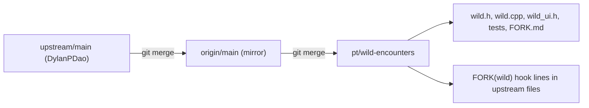

# Wild Pokemon battles (fork-only)

## Fork strategy (applies to every step)

- **New code goes in new files.** Upstream never touches these, so they never conflict:
  - `wild.h` / `wild.cpp`: pure logic, testable without the sketch.
  - `wild_ui.h`: the screens, compiled inside the sketch.
  - `tools/emu/tests/wild_test.cpp` and `wild_ui_test.cpp`.
  - `FORK.md`.
- **Upstream files only get hooks.** A hook is a single call or condition, tagged `// FORK(wild)`. Running `rg "FORK\(wild\)"` lists every one of them, which is the checklist after each upstream merge.
- **No refactoring of upstream code.** That drops two items from the first draft: the `btlResetState()` extraction and the `speciesPlayable()` refactor of the egg code. Refactoring their code is exactly what turns a routine merge into a hand merge.
- **Reuse upstream code; don't copy it.** The wild chooser runs on the existing region chooser through a new mode, rather than a duplicated screen. A copy would silently miss every upstream fix to that screen, such as hit areas or paging.
- **Nothing positional is shared with upstream:**
  - Strings stay out of the positional `STRINGS` table in `i18n.cpp`, which upstream appends to every release. Each new upstream string would conflict with ours.
  - The NVS key carries a fork prefix (`w_seen`), so it can never collide with a key upstream adds later.
  - The `SCR_` enum is not changed (see the hooks section).
- **Leave version-like files alone:** `FW_VERSION`, the README badge and the `web/` binaries.
  - All three conflict on every upstream release.
  - Keeping `FW_VERSION` the same also keeps LAN battles working with boards running upstream builds, since this feature does not touch the link protocol.
- **Upstream bugs found along the way go upstream as their own small PRs** from a branch off `main`, not into this branch:
  - A trainerless win prints `S_BTL_LOSE`; see `TamaPoke.ino` lines 3644-3645.
  - The false energy comment at line 3631.

## Upgrade safety: an existing install updates in place, never wiped

The rule is simple. The fork only ADDS state, and every reader tolerates that state being absent, too short or too long. Nothing that already exists is reinterpreted. That covers both directions: upstream to fork, and back again.

- **No existing NVS key is renamed, resized or re-typed.** The fork adds one key, `w_seen`.
  - Absent (every current install): the bitmap stays all zeros, and nothing is migrated or written at boot.
  - Shorter than expected (a later upstream merge grew `DEX_COUNT`): it reads into the front of the array, the same pattern as `loadBlob()` in `pet.cpp`. `wild.cpp` gets its own copy, because `loadBlob` is `static` there and making it public would mean an upstream edit.
  - Longer than expected: it is truncated, never overflowed.
  - It is written only when a new bit is set, never on boot. So simply flashing the fork changes nothing in NVS until the first wild encounter.
- **Nothing in `Pet`, `Party` or the box changes shape.**
  - No new fields on `Pet` or `PartyMon`, so the party and box blob strides cannot move.
  - The live-pet energy spend and the training reward go through the existing public API (`pet.energy`, `pet.rewardTraining`, `pet.flushSave`). They write the same keys as today, with the same types.
  - The move-index tables (`MOVES`, append-only) and the dex tables are not touched.
- **Flashing back to upstream is safe.** Upstream firmware never reads `w_seen`. Its `EXPORT` leaves the key out, and its `IMPORT` skips keys it does not know: `fieldFor()` returns null and the key is ignored.
- **Backups work in both directions.**
  - A fork `EXPORT` restores on upstream, minus the seen bitmap.
  - An upstream `EXPORT` restores on the fork with the seen bitmap at zero.
  - Caveat, for `FORK.md`: `IMPORT` clears the namespace first, so restoring an upstream backup onto the fork resets the seen bitmap.
- **The flash layout is unchanged.**
  - Same FQBN and `PartitionScheme=app3M_fat9M_16MB`. A different partition table moves or wipes NVS and the FAT.
  - Flash with `arduino-cli upload`, which writes only the app. If anyone uses the web installer, keep the existing four-part manifest and decline its erase prompt (`new_install_prompt_erase` stays as it is). Never add an erase step.
- **No new SD assets.** Wild battles use the sprite packs already on the card, so nobody has to re-download or re-copy anything.
- **LAN battles with upstream boards still work.** `FW_VERSION`, the link protocol and the table fingerprint in the hello are unchanged. The fork adds no moves and no species.
- **`wild_upgrade_test` (new, fresh harness) proves all of the above:**
  - Seed the emulated NVS by running the real upstream `Pet`/`Party` code, then snapshot every key.
  - Boot the fork's `setup()` and run a wild battle.
  - Assert that every pre-existing key is byte-identical, except the ones a normal battle legitimately writes (energy and training). Assert that the pet's species, level, IVs, moves, nickname, party, box, badges and Pokedex all compare equal.
  - Repeat with a short and an over-long `w_seen` blob.
  - Negative-check the test by making `wildLoad()` write at boot and by growing a `PartyMon` field: both must fail it.

## Gameplay (unchanged from the first draft)

The flow is: gym region chooser, then WILD, then the region chooser in wild mode, then the team picker, then the battle.

- **Species:** `wildRoll(region, lvl)` in `wild.cpp`.
  - About 85% of rolls are `R_COMUN` and about 15% are `R_RARO`. It never returns a legendary.
  - It never falls back to another region, and it returns -1 if the region is locked.
  - Every candidate must pass `regionAvailable(regionOfDex(d)) && speciesHasArt(d)`, which are existing public helpers.
  - It walks `evolvesTo` forward while `lvl >= evolveLevel`, stopping at EEVEE and at any unplayable target.
- **Level:** the squad's highest level minus 0 to 5, clamped to 2..`MAX_LEVEL`. Opponent IVs stay at 20.
- **Cost:** the live pet spends 8 energy per wild battle (`pet.energy` is public, then `pet.flushSave()`). A battle is refused when energy is below 25, when the pet is asleep, or while it is still an egg.
- **Reward:** on a win, and only if `btlPetIn`, call the existing public `pet.rewardTraining(1 + random(2), which)`. Running away or losing gives nothing.
- **Seen:**
  - Stored as a bitmap in `wild.cpp`, under NVS key `w_seen`, in the same `"tamapoke"` namespace. That means `WIPE` clears it and `EXPORT`/`IMPORT` carry it automatically, because both are key-driven.
  - `wildSeen(d)` returns `bit || pet.isRegistered(d)`.
  - The bit is set when the encounter starts.
  - It lives outside `Pet`, so no ending can clear it.

## New files

- [wild.h](wild.h) / [wild.cpp](wild.cpp):
  - `wildRoll`, `wildLevelFor`, `wildCanStart`, `wildSpend`, `wildReward`
  - `wildMarkSeen`, `wildSeen`, `wildSeenCountIn`, `wildLoad`, `wildSave`
  - `const char *WT(WildStr)`, which reads its own `[LANG_COUNT][W_COUNT]` table through `gLang`, ASCII only.
  - No sketch or SD dependency, so it links into tests the same way `pet.cpp` does.
- [wild_ui.h](wild_ui.h): included once at the very bottom of `TamaPoke.ino`, so it can use the sketch's globals and statics without arduino-cli or `genproto.py` changes. It holds:
  - `startWildBattle(region)`: calls `startBattle(dex, lvl, squadMask)`, sets `btlWild`, marks the species seen and prints "A wild X appeared".
  - `wildBattleOver()`: the reward and narration, returning true if it handled the end of the fight.
  - `wildLanBtnRects()`, the WILD button draw/tap, and the `WILD [region]` serial command.
  - Forward declarations go in `wild.h`, which is included at the top of the sketch.

## Hook points in upstream files (each tagged `// FORK(wild)`)

- [TamaPoke.ino](TamaPoke.ino):
  - Top: `#include "wild.h"`. Bottom: `#include "wild_ui.h"`.
  - `setup()`: `wildLoad();`
  - `startBattle(int16_t dex, uint8_t lvl, uint16_t mask = 0xFFFF)`: a defaulted parameter passed to `buildSquad`. The only signature change, and existing callers are untouched.
  - The gym chooser (lines ~4960 and ~1693): narrow the LAN rectangle and add `wildDrawBtn()` / `if (wildTapBtn(x,y)) return;`.
  - `RPICK_FOR_WILD 3`: one case each in `rpickRegions` (`GAL_REGIONS`), `rpickModeNow`, the subtitle switch (`wildSeenCountIn`), the title, and the `regionPickTap` caller.
  - `uiCurrentScreen()`: the wild chooser reports the existing `SCR_GYMPICK`. Not adding an `SCR_` value keeps `SCREEN_NAME`, the enum and the upstream `flush_test`/`release_test` untouched. Because the result is still not `SCR_MAIN`, the long-press release guard stays closed.
  - `pickTap`/`renderPick`: `PICK_WILD 0xFE` branches for the BACK target, the FIGHT action and the title. `squadCap` already returns 6 for any index past the roster.
  - End of battle (line ~3618): `if (btlWild && wildBattleOver()) return;` placed before the trainer branches. `btlRun` clears `btlWild`.
  - The serial dispatcher: `if (wildSerial(line)) return;`
  - Pokedex detail (line ~5572): show the name when `wildSeen(galleryDetail)`.
- [save.cpp](save.cpp): append `{ "w_seen", <the existing blob kind> }` at the end of `SAVE_FIELDS`. `save_test` fails if a key in NVS is missing from that list.
- [tools/emu/build.sh](tools/emu/build.sh) and [tools/emu/tests/run.sh](tools/emu/tests/run.sh): add `wild.cpp` to the source lists, and `wild_ui_test` and `wild_upgrade_test` to `needs_sketch`.

## Tests (new files only; each guard negative-checked)

- `wild_test`:
  - Every roll stays in its region, has art, and is never legendary.
  - A locked region returns -1. Its companion check proves that an unlocked region does roll.
  - The evolution walk follows `evolvesTo` and `evolveLevel`.
  - The energy cost is spent, and the battle is refused below 25.
  - The reward goes only to the live pet, and only when it fought.
  - The seen bitmap survives all three endings and a reload. It loads as zeros from a save that predates it, and it appears in an `EXPORT`.
  - The foe is seen, not registered.
  - Every `WT()` string is non-null and ASCII in all 6 languages.
- `wild_ui_test` (fresh harness):
  - The WILD button and the narrowed LAN button both meet `UI_TAP_MIN` and do not overlap.
  - The chooser flushes, pages, and greys locked regions.
  - The screen is not `SCR_MAIN`, and a 3-second hold does not offer a release.
  - BACK returns to the right place, and FIGHT starts a wild battle.
- The existing 34 suites must still pass unchanged. That is the proof the hooks did not disturb upstream behaviour.

## Docs and sync

- [FORK.md](FORK.md):
  - The wild-battle numbers: the 85/15 odds, the level window, the energy cost and the reward.
  - Every hook point.
  - The sync procedure:
    - `git fetch upstream`
    - `git checkout main && git merge --ff-only upstream/main`
    - `git checkout pt/wild-encounters && git merge main`
    - `rg "FORK\(wild\)"`, then run `tools/emu/tests/run.sh`
  - After a sync, rebuild `web/` locally, but do not commit it.
  - The upgrade rules, for any future fork feature:
    - Only add NVS keys, with the `w_`/fork prefix.
    - Tolerate an absent, short or long blob.
    - Never write at boot.
    - Never change the partition scheme.
    - Decline the installer's erase prompt.
    - Re-run `wild_upgrade_test` after every upstream merge, because upstream save changes are exactly what could break it.
- README.md, CLAUDE.md and `FW_VERSION` are not edited.

